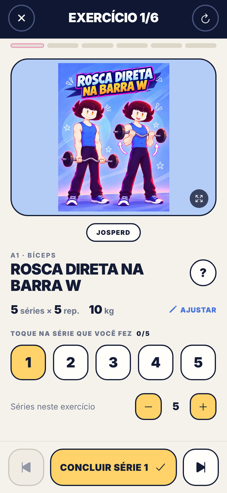
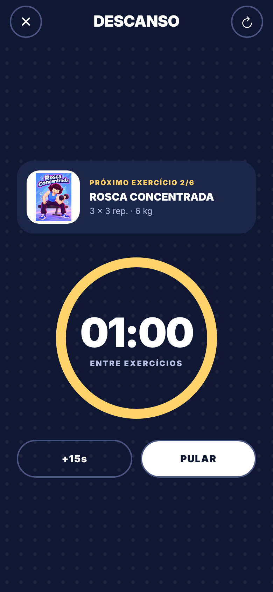
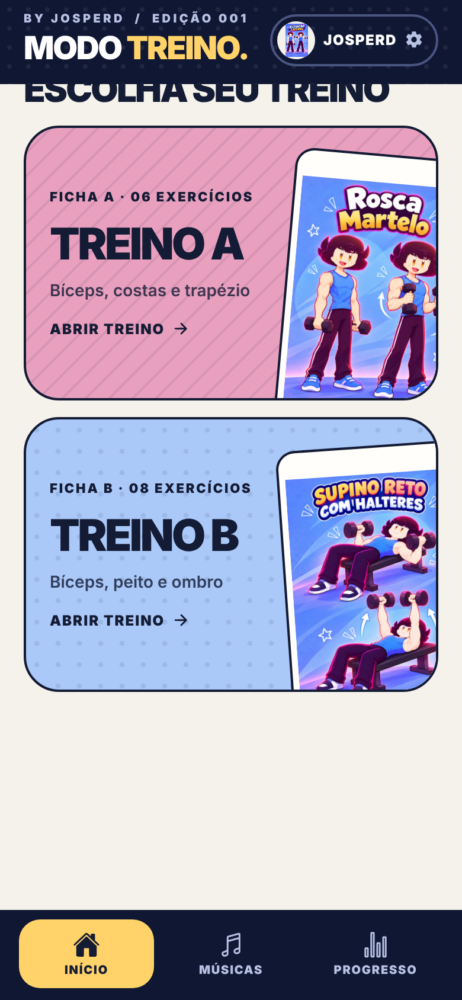
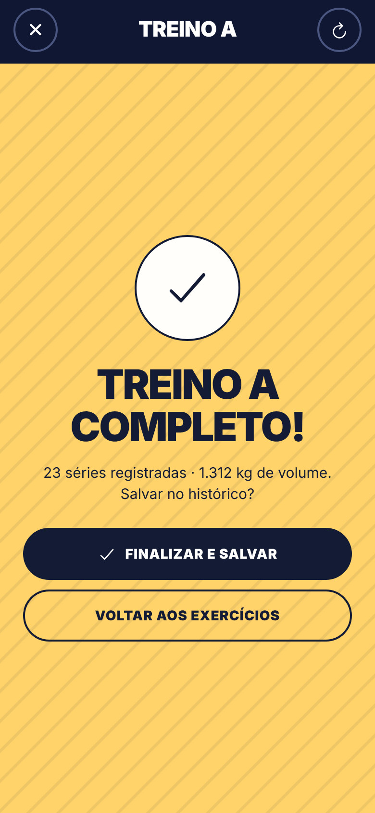
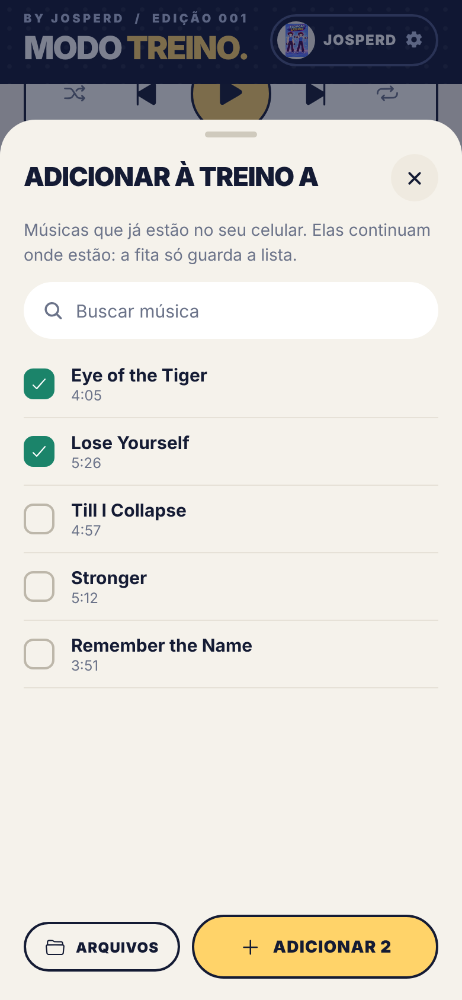
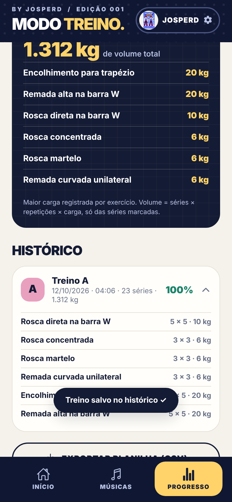

<div align="center">

# 💪 MODO TREINO
### *by Josperd*

**O seu diário de treino ilustrado.** Marque quantas séries você fez, descanse no tempo certo, ouça sua fita cassete e acompanhe sua evolução, tudo salvo no seu aparelho. Sem conta. Sem anúncios.

[](https://github.com/Josperdias/Modo-Treino/actions/workflows/check.yml)
[](https://github.com/Josperdias/Modo-Treino/releases)


### [🌐 Abrir o site](https://josperdias.github.io/Modo-Treino/) &nbsp;·&nbsp; [📲 Baixar o app Android](https://josperdias.github.io/Modo-Treino/baixar/) &nbsp;·&nbsp; [🗂️ Todas as versões](https://github.com/Josperdias/Modo-Treino/releases)

<br>






</div>

---

## ✨ O que tem aqui

| | |
|---|---|
| 🃏 **Modo Execução** | Um card por exercício, em tela cheia. **Toque em quantas séries você fez** (tocar em "3" registra 3; tocar de novo corrige). **O descanso é só entre um exercício e outro** (com **+15s** e **Pular**); descanso entre séries é opcional, nos Ajustes. |
| 🖼️ **Ilustração inteira + zoom** | As artes do Josperd aparecem **inteiras**, sem corte. Toque na imagem para ampliar até 600% (pinça, toque duplo, roda do mouse, arrastar). |
| 🏋️ **Treinos A e B** | 14 exercícios (6 + 8) com séries, repetições e cargas **editáveis**. Você escolhe quem treina com você: **Josperd** ou **Camila Camomila, a ruivinha**. |
| 📈 **Histórico de verdade** | Volume por treino (séries × repetições × carga), detalhe por exercício, **recordes pessoais** e exportação em **CSV**. |
| 📼 **Modo Música** | **No app Android:** as fitas usam as **músicas que já estão no seu celular, sem importar nem copiar**. Tirar uma música da fita **não apaga o arquivo**. Crossfade de 0 a 8 s, cassete animado e **mini player dentro do treino**. No site, você importa os arquivos. Sem baixar nada de terceiros. |
| 🔊 **Sons opcionais** | Estilos *Suave*, *Arcade* e *Minimal*, contagem **3-2-1 falada em português**. **Tudo vem desligado**; você escolhe o que quer ouvir. |
| 📴 **Funciona offline** | Ilustrações, sons e seus registros ficam no aparelho. Instale como app pelo navegador. |
| 🔔 **Avisos de versão nova** | O app e o site avisam quando sai uma release nova (veja abaixo). **Nada se instala sozinho.** |
| 💾 **Seus dados são seus** | Backup em JSON (validado), planilha CSV. Nada é enviado a servidor algum. |

<div align="center">







<sub>Capturas do app geradas com react-native-web (mesmo código do app); as músicas do "celular" nelas são simuladas. Prints do site: <code>screenshots/v1.1.0/</code>.</sub>

</div>

## 🚀 Como usar

### 1) Pelo navegador (qualquer celular ou computador)
Abra **https://josperdias.github.io/Modo-Treino/** e use. Para virar app:
- **Android (Chrome):** menu ⋮ → *Instalar app*
- **iPhone (Safari):** Compartilhar → *Adicionar à Tela de Início*
- **Computador:** ícone de instalar na barra de endereço

### 2) App Android (APK de teste)
1. Abra **[a página de download](https://josperdias.github.io/Modo-Treino/baixar/)** no celular e toque em **Baixar APK**.
2. Abra o arquivo e permita instalar de "fonte desconhecida" só para essa instalação.
3. Confira o **SHA-256** mostrado na página com o do arquivo baixado.

> ⚠️ É um **APK de teste** (assinado com a chave de depuração do template Expo): serve para avaliação, **não é a versão da Play Store**. Exporte um backup (Ajustes → Exportar) antes de trocar de versão.
> Não existe app para iOS; no iPhone use o site instalado pelo Safari.

## 🔔 Avisos de versão nova

- **Ao abrir ou voltar para o app** (com internet), ele consulta as releases públicas deste repositório. Se existir uma versão **maior** que a instalada, mostra um aviso com **Ver release** e **Baixar APK**.
- O site mostra a mesma faixa de aviso e o cartão **"Baixe o app Android"** na página inicial (com versão e tamanho quando existe um APK publicado).
- Um *commit* novo **não** é "versão nova": só uma **release com APK** conta.
- **Não há notificação push em tempo real** (isso exigiria um servidor) e **nunca há instalação automática**: você decide baixar.
- Dá para desativar em **Ajustes → Atualizações do GitHub**.

## 🧑‍💻 Para quem desenvolve

```bash
# site/PWA
python3 -m http.server 8000 -d site          # http://localhost:8000

# app Expo (SDK 54)
cd native && npm ci && npx expo start

# testes
npm test                                      # estrutura + lógica (29 testes)
npm ci && npx playwright install chromium && npm run test:e2e   # site no Chromium (48 testes)
```

- **CI** (`.github/workflows/check.yml`): estrutura e lógica, site no Chromium e app (typecheck, bundle Android e interface via react-native-web).
- **APK** (`android-apk.yml`): compila um APK *standalone* (`assembleRelease`), confere pacote e assinatura com `apksigner`/`aapt2` e publica o **SHA-256**.
- **Site** (`pages.yml`): publica a pasta `site/` no GitHub Pages.
- **Lançar versão nova:** `node scripts/bump-version.mjs 1.2.0` → PR → merge → rode **Actions → Android - APK de teste → Run workflow** com *publicar* marcado. Detalhes em **[docs/MANUTENCAO.md](docs/MANUTENCAO.md)**.

```text
site/        site/PWA (HTML + JS puro, offline) + /baixar/
native/      app React Native + Expo (SDK 54)
shared/      regras puras (versões, volume, recordes, backup) — fonte única
tests/       unitários, e2e do site e da interface do app
scripts/     sincronização, versão e captura de prints
docs/        manutenção, como liberar merge, exemplos
```

> **Status honesto:** o site e a interface do app são testados em navegador (Chromium). **O app nativo ainda não foi testado em aparelho Android** (áudio nativo, seletor de arquivos, segundo plano). Veja o [CHANGELOG](CHANGELOG.md).

## 🎨 Arte, identidade e créditos

- **Ilustrações e personagens © Josperd.** **Josperd** e **Camila Camomila, a ruivinha**, usados apenas neste projeto. Não há licença de reutilização das artes.
- Quando falta a arte da Camila, o app mostra a de Josperd **com aviso**; quando não há arte do movimento, mostra uma capa decorativa com **"SEM IMAGEM DO EXERCÍCIO"**. Nunca uma arte substituta como se fosse a demonstração.
- Tipografia: **Barlow Condensed** e **DM Sans** (SIL Open Font License, incluídas em `site/assets/fonts/` com as licenças). A fonte *Le Cartoonie* só entra com licença.
- O crossfade se inspira conceitualmente em [howler.js](https://github.com/goldfire/howler.js) e [Gapless-5](https://github.com/regosen/Gapless-5) (MIT); a implementação é própria e **não há código deles aqui**.
- Links do YouTube são apenas atalhos para o player oficial; o app **não baixa** áudio do YouTube.

## ⚖️ Aviso

O Modo Treino é um diário pessoal e **não substitui orientação profissional**. Consulte um profissional para cargas e execução adequadas. As séries do Treino B são valores provisórios e editáveis.

<div align="center"><sub>MODO TREINO © 2026 · Feito com movimento. Ilustrado por Josperd.</sub></div>
