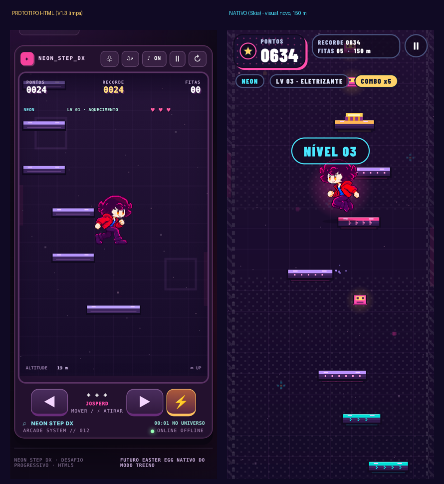

# NEON STEP DX — M1: comparação com o protótipo HTML

M1 = vertical slice jogável (Cidade Neon, Josperd e Camila, toque/inclinação, pausa, recorde, desbloqueio). Tudo abaixo foi **medido** (scripts em `baseline/`); o que não pude medir está marcado.

## 1. Física (o modelo físico adotado e a paridade)

Referência teórica do salto: v²/2g = 690²/2400 = **198,375 un.**

| | Protótipo (semi-implícito, dt variável) | Nativo M1 (Verlet exato, passo fixo 1/120 s) |
|---|---|---|
| Ápice a 30 Hz | 187,0 | **198,375** |
| Ápice a 60 Hz | 192,7 | **198,375** |
| Ápice a 120 Hz | 195,5 | **198,375** |
| Ápice a 240 Hz | 196,9 | **198,375** |
| Mesma partida em 30/60/120/144/240 Hz | resultados diferentes | **mesmo estado final** (hash idêntico, teste) |
| Abaixo de ~31 fps | câmera lenta (dt limitado a 32 ms) | segue em tempo real (até 24 passos por quadro) |
| Ápice após pousar (qualquer altura) | — | 198,375 ± 0,02 (sub-passo exato, teste com 5 alturas) |

Os números aprovados (g 1200, salto 690, mola 930, impulso 835, velocidade lateral 282+) **não mudaram**. O salto sobe 3 % a mais que o protótipo a 60 Hz (192,7 → 198,375); os degraus do mundo foram dimensionados para o novo modelo (nunca passam de 78 % do ápice).

## 2. Distribuição de plataformas (a queixa: "distribuição de piso muito ruim")

Protótipo: cada plataforma sorteada sozinha (lateral aleatória, largura quase fixa). Nativo: **padrões** (degraus, torre, bifurcação, móveis, zigue-zague, mola, quebráveis, plataforma larga de respiro) com ritmo de tensão/respiro por altitude e primeiros 28 m só de degraus fáceis. 40 sementes × 1 500 plataformas cada.

**Protótipo**

| Altitude (m) | Degrau (un.) | Desvio lateral (un.) | Laterais > 120 | Seq. média p/ o mesmo lado | Seq. ≥ 3 | Largura (un.) | Plataformas especiais |
|---|---|---|---|---|---|---|---|
| 0-70 | 103.3 ± 7.4 | 49.2 ± 32.9 | 0 % | 1.53 | 10.9 % | 92 (mín. 92) | 0 % |
| 70-145 | 106.9 ± 9.1 | 41.2 ± 34.5 | 0 % | 1.61 | 14.1 % | 86.9 (mín. 74) | 16.5 % |
| 145-245 | 111.2 ± 9.7 | 48.1 ± 37.6 | 0 % | 1.73 | 15.8 % | 82.5 (mín. 71) | 27.5 % |
| 245-360 | 115.5 ± 11.5 | 52.5 ± 38.2 | 3.5 % | 1.5 | 9.8 % | 78.2 (mín. 62) | 29.1 % |
| 360-∞ | 119.4 ± 12.4 | 50.3 ± 39.3 | 4.4 % | 1.71 | 17.8 % | 73.4 (mín. 58) | 32.5 % |

**Nativo M1**

| Altitude (m) | Degrau (un.) | Desvio lateral (un.) | Laterais > 120 | Seq. média p/ o mesmo lado | Seq. ≥ 3 | Largura (un.) | Plataformas especiais |
|---|---|---|---|---|---|---|---|
| 0-70 | 96.9 ± 7.7 | 53.2 ± 34.7 | 1.1 % | 2.04 | 30 % | 105.4 (mín. 77) | 3.5 % |
| 70-145 | 96.4 ± 8.6 | 41.6 ± 31 | 0.7 % | 1.7 | 18.9 % | 89.1 (mín. 74) | 55.2 % |
| 145-245 | 122.8 ± 48.6 | 84.8 ± 56 | 45.4 % | 1.35 | 6.2 % | 88.3 (mín. 65) | 17.7 % |
| 245-360 | 118.8 ± 17.2 | 63.7 ± 42.2 | 11.7 % | 1.65 | 15.9 % | 71.9 (mín. 59) | 18.2 % |
| 360-∞ | 117.7 ± 23.6 | 61.4 ± 43.6 | 13.7 % | 1.88 | 23.8 % | 77 (mín. 57) | 18.1 % |

Leitura:
- **Variedade cedo.** No protótipo só 16,5 % das plataformas entre 70 e 145 m eram especiais (móvel/quebrável/mola) e a mola quase nunca aparecia. No nativo cada novidade é **apresentada uma vez, em ordem e cedo**: bifurcação (≤ 90 m), móveis (primeira aos 80–110 m), quebráveis (115–150 m), mola (165–200 m) e zigue-zague (≤ 255 m), e depois entra no sorteio por intensidade. A faixa 70–145 m (55 % de especiais) é, de propósito, a de "apresentação" e provavelmente será suavizada no balanceamento.
- **Estrutura legível.** Nos primeiros 70 m, 30 % das plataformas formam escadas de 3 ou mais para o mesmo lado (protótipo: 11 %). Em 145–245 m a sequência média cai porque o **zigue-zague** (alternar de lado) é um padrão deliberado, e os desvios laterais grandes (45 % > 120 un.) vêm dele e do lançamento da mola — o protótipo nunca passava de 4 %.
- **Largura** das plataformas varia com a altitude (105 → 77 un.), em vez de quase fixa; degrau médio sobe de 97 a 123 un.
- Degraus de 225–268 un. são o **lançamento da mola** (ápice 360), sempre com plataforma larga no destino e fitas no caminho.
- Ainda não há esteira nem plataforma estreita (virão com os mundos, M2).

## 3. Jogabilidade provada por robôs (testes automáticos, 100 % reprodutíveis)

| Robô | Reação / erro de mira | Resultado |
|---|---|---|
| Ideal | imediata, sem erro | 0 quedas em 25 sementes × 240 s (> 1 500 m em todas) |
| Humano | 150 ms, ±14 un., 6 % de descuido | ≤ 3 quedas em 25 sementes × 240 s |
| Descuidado | 250 ms, ±30 un., 10 % de descuido | 15 a 29 quedas em 30 sementes × 300 s; mediana > 300 m |

(O robô do protótipo do baseline é outro e o protótipo não tem semente: comparar números absolutos entre os dois seria enganoso. O que vale é: no nativo o mundo é **provadamente** alcançável; no protótipo isso nunca foi provado.)

## 4. Desempenho

| Medida | Protótipo (desktop) | Nativo M1 |
|---|---|---|
| Custo da simulação | ≈ 0,007 ms/quadro (Chromium) | **1.55 µs por passo** (≈ 3.09 µs por quadro a 60 Hz, Node) |
| Custo de desenho (lado JS) | ≈ 1,3 ms/quadro (canvas 2D, Chromium) | ≈ 2.09 ms/quadro (gravar o `Picture`, Chromium + SwiftShader) |
| Memória em sessão longa | não medido | **estável**: heap 7.53 → 7.53 MB em 30 min simulados (23385 m); ≤ 20 plataformas e ≤ 9 itens vivos |
| FPS em celular | não medido | **NÃO MEDIDO** — o APK traz o medidor (Pausa → Medidor de desempenho); preciso do número do seu aparelho |

O FPS do Chromium sem GPU (≈ 26 fps, p95 150 ms) é limitado pelo WebGL por **software** do ambiente de teste e **não representa um celular**. Também não verifiquei em aparelho: inclinação, toque multi-dedo real, vibração e o consumo de memória nativa do Skia (por isso os `Picture` antigos são liberados com `dispose()`).

## 5. Telas cobertas por teste de interface (12 testes no Chromium, Skia/CanvasKit real)

Desbloqueio (6 toques não bastam; dica só a partir do 4º; pausa > 1,5 s zera; persiste ao recarregar) · seleção e recordes por personagem · o Skia **pinta de verdade** (cores, plataformas) · teclado · **toque multi-dedo** (direita +1, esquerda −1, os dois 0, soltar um dedo com o outro na tela) · pausa congela e retoma sem salto de tempo · medidor e configurações salvos · fim de jogo grava o recorde e permite jogar de novo · layout em 360×640, 393×852 e 412×915 · sair · desempenho. Esse conjunto achou **um bug real de controle** (soltar um dedo com o outro apoiado não atualizava o eixo), já corrigido.

## 6. Capturas

`screenshots/m1-neon-step/`: `00-ajustes-fliperama`, `01-selecao`, `01b-selecao-camila`, `02-jogando`, `02b-mundo-avancado-josperd`, `02b-mundo-avancado-camila`, `03-pausa`, `04-medidor`, `05-fim`, `06-layout-*`, `comparacao-prototipo-vs-nativo`.

## 7. O que ficou de fora de propósito (M2 em diante)

Inimigos/projéteis/poderes/portais e os outros mundos · checkpoint na Cidade Neon · Papel com itens e portal espelhados e regras de troca de personagem por mundo · áudio e música · arte nova (continuam desenhos simples; nada experimental reintroduzido).
